# Finance Tracker & Analytics Dashboard

A responsive financial management dashboard developed to demonstrate frontend engineering skills, component-based architecture, state management, data visualization, and user experience optimization.

**Technology Stack**

React.js | Vite | JavaScript | Tailwind CSS | Vercel

---

## Project Overview

The Finance Tracker is a web application designed to organize financial transactions and visualize financial information through an interactive dashboard.

The application demonstrates modern frontend development practices, reusable components, responsive layouts, and centralized state management.

**Note:** This project was developed for assignment and demonstration purposes. Some financial data is static.

---

## Live Demo

**[Finance Tracker & Analytics](https://bit.ly/Finance-Tracker_SubramanyaV)**

---

## Application Preview

### Desktop - Light Mode

<p align="left" gap="2">
  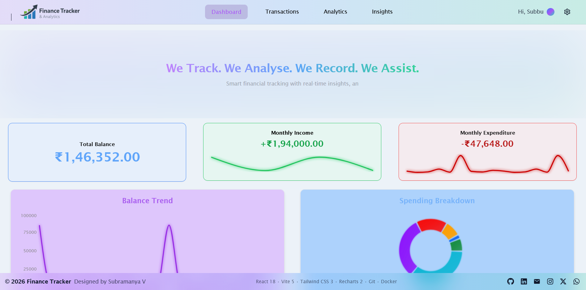

  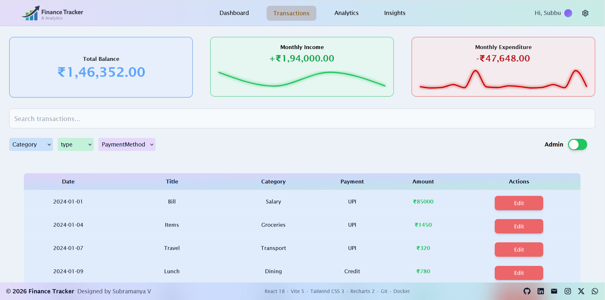

  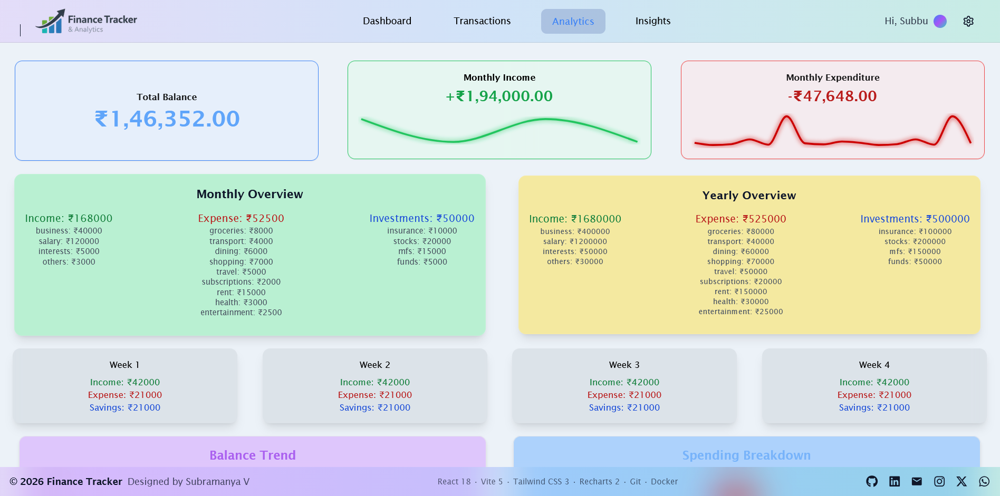

  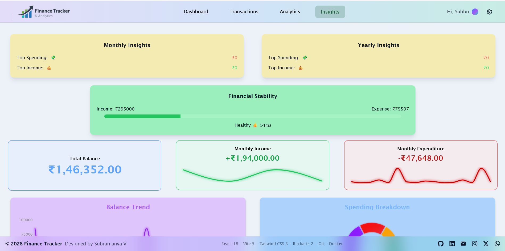

  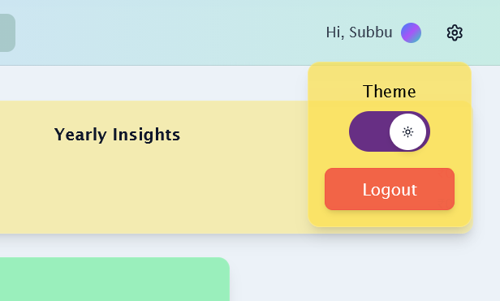

  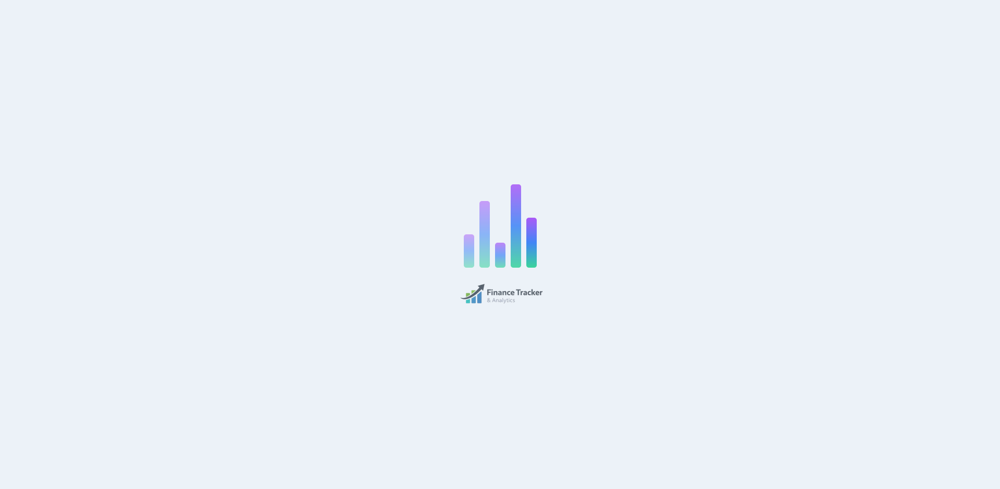
</p>

### Desktop - Dark Mode

<p align="left" gap="2">
  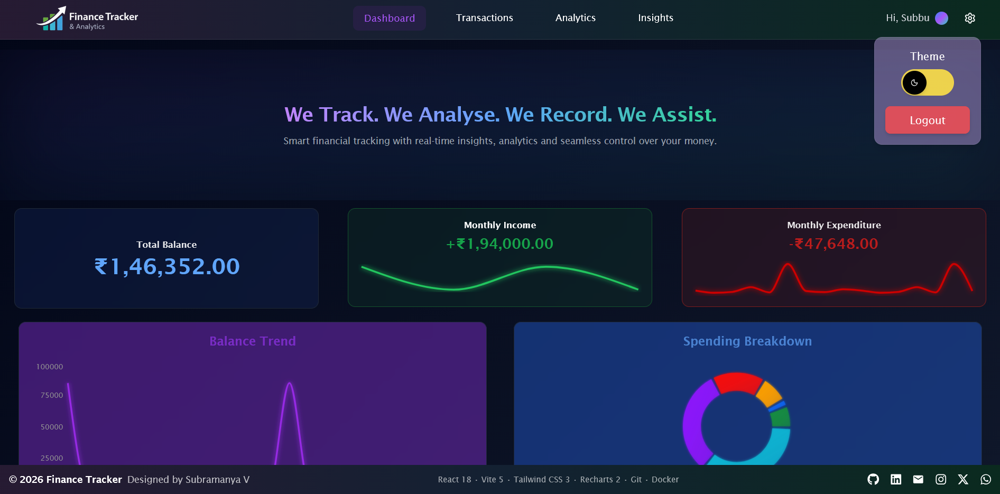

  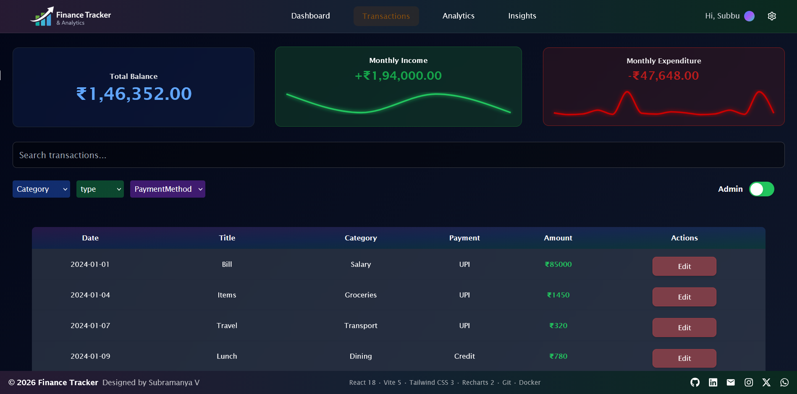

  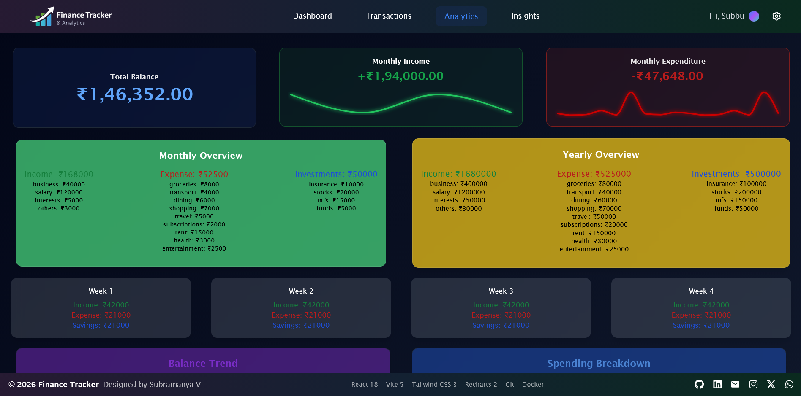

  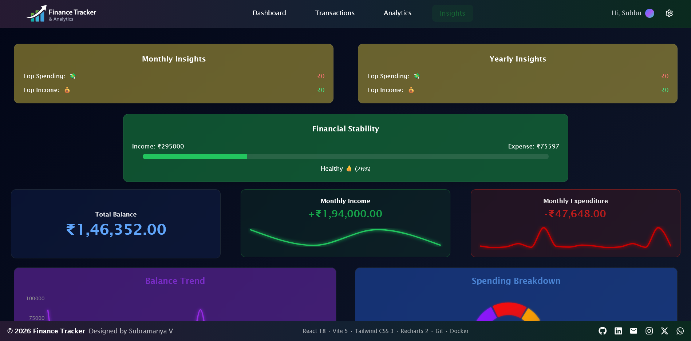

  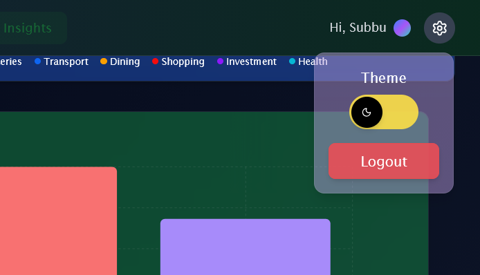

  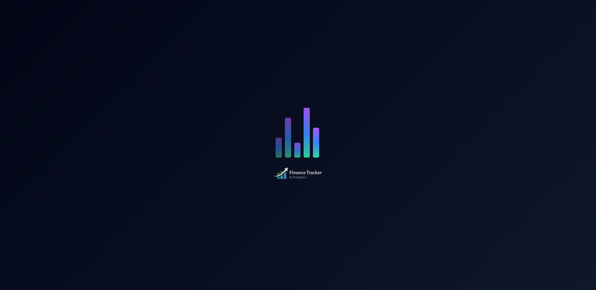
</p>

### Mobile - Light Mode

<p align="left" gap="2">
  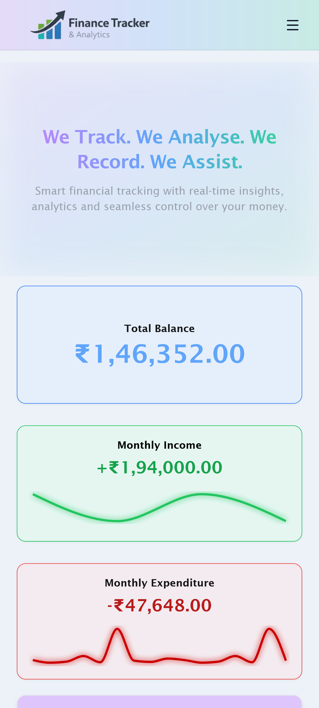

  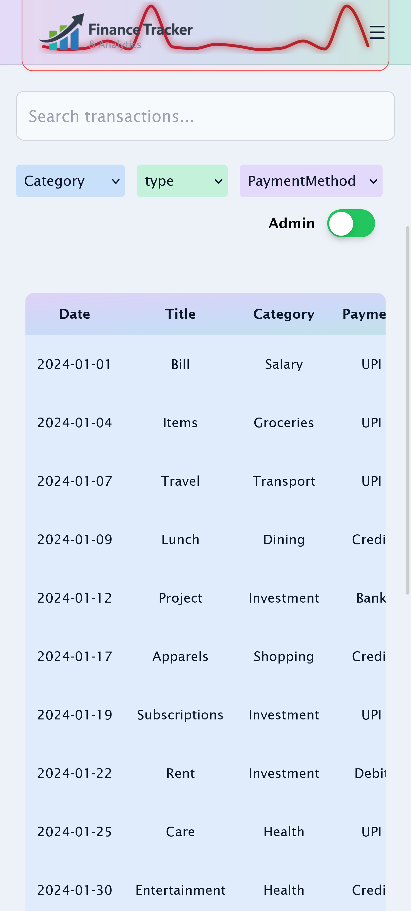

  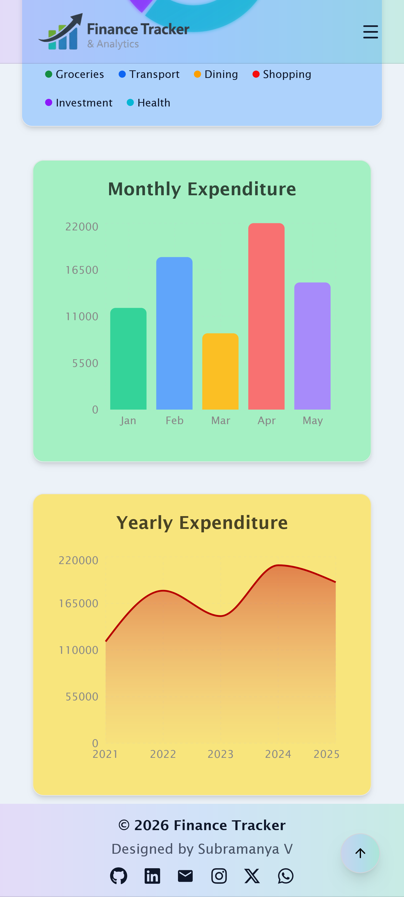

  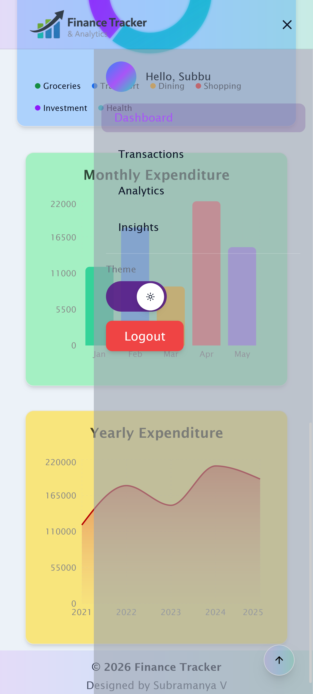

  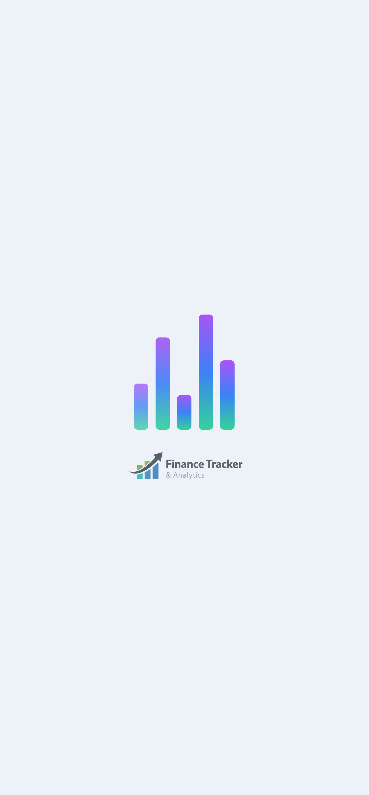
</p>

### Mobile - Dark Mode

<p align="left" gap="2">
  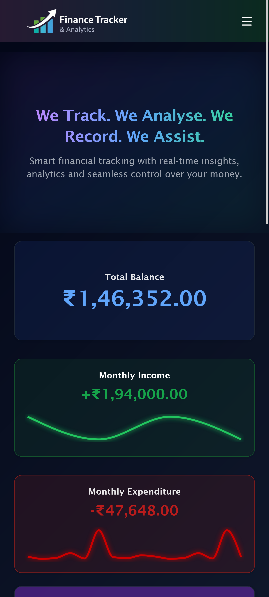

  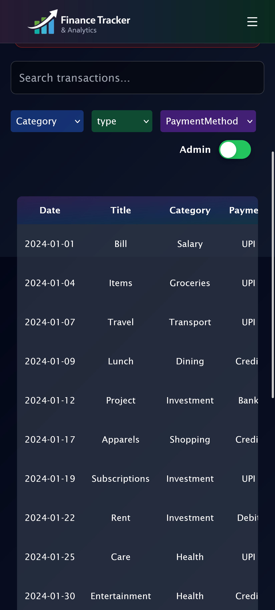

  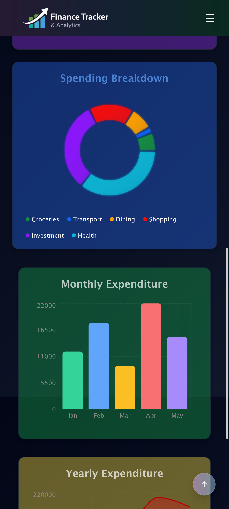

  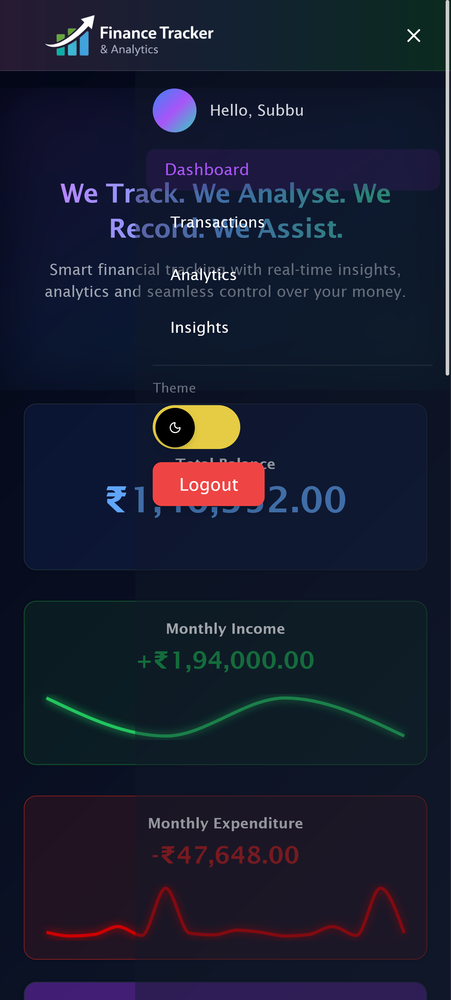

  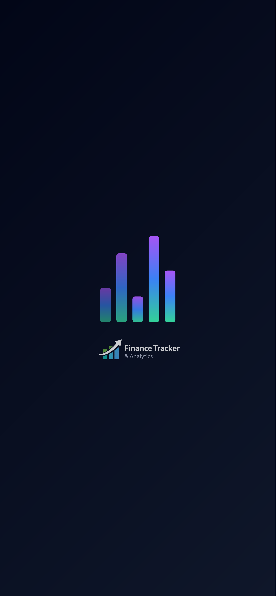
</p>

---

## Key Features

### Financial Management

- Transaction management.
- Income and expense tracking.
- Financial summary dashboard.
- Interactive analytics and insights.
- Role-based interface behavior for Viewer and Admin.

### User Interface

- Light and dark theme support.
- Responsive layouts for desktop and mobile devices.
- Smooth page transitions and animations.
- Interactive dashboard components.
- Horizontal scrolling sections.

### Performance and User Experience

- Global skeleton loading system.
- Animated chart and loading components.
- Controlled loading states.
- Lazy rendering patterns.
- Optimized asynchronous operations.

---

## Application Modules

| Module | Description |
|---|---|
| Dashboard | Financial summaries, balance cards, and analytics charts |
| Transactions | Transaction listing and role-based editing |
| Analytics | Financial data visualization and graphical insights |
| Insights | Financial trends and behavioral analytics |
| Settings | Application preferences and theme configuration |

---

## Component Architecture

The application follows a modular, reusable component structure.

### UI Components

- Balance, Income, and Expense Cards
- Bar, Donut, and Line Charts
- Theme Toggle

### Utility Components

- ScrollToTop
- RoleToggle
- HorizontalScroll
- Drag-and-Drop interactions

### Loading Components

- SkeletonLoader
- AnimatedBars
- Global Loading Context

Drag-and-drop interactions are implemented for the Total Income, Expenditure, and Balance cards across desktop and mobile layouts.

---

## State Management and Implementation

The application uses React Context API for centralized state management and React Hooks for component-level behavior.

Key implementation approaches:

- React Context API for global loading state.
- useState for local component state.
- useEffect for managing side effects.
- Promise.all for concurrent asynchronous operations.
- Reusable components to reduce code duplication.
- Responsive-first design principles.
- Separation of UI components and application logic.

---

## Technical Highlights

- Modular and maintainable component structure.
- Reusable UI components.
- Centralized loading state management.
- Responsive design across different screen sizes.
- Interactive data visualization.
- Theme management.
- Asynchronous operation handling.
- User experience-focused loading strategies.

---

## Installation and Setup

### Prerequisites

- Node.js
- npm
- Git

### Clone the Repository

```bash
git clone <your-repository-url>
```

### Navigate to the Project Directory

```bash
cd finance-tracker
```

### Install Dependencies

```bash
npm install
```

### Start the Development Server

```bash
npm run dev
```

The application will be available at the local development URL provided by Vite.

---

<div align="center">

  Subramanya Veeregowda | Full Stack Developer | Data Engineer <br />

  [](LINKEDIN_URL)
  [](https://your-portfolio-link.com)
  [](GITHUB_URL)
  [](LEETCODE_URL)
  [](HACKERRANK_URL)
  [](NEETCODE_URL)
  [](WHATSAPP_URL)
</div>
